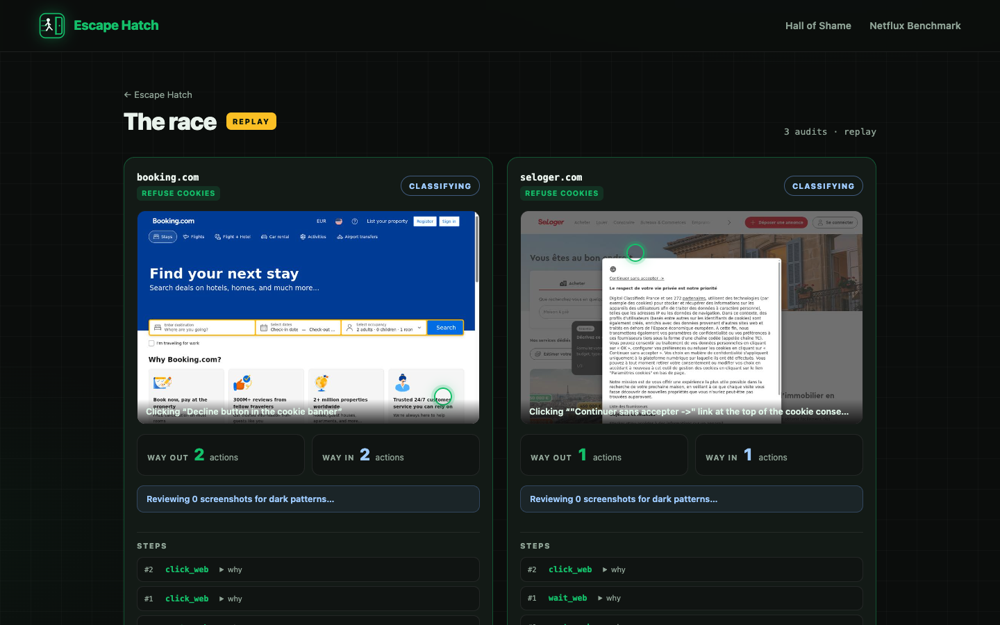
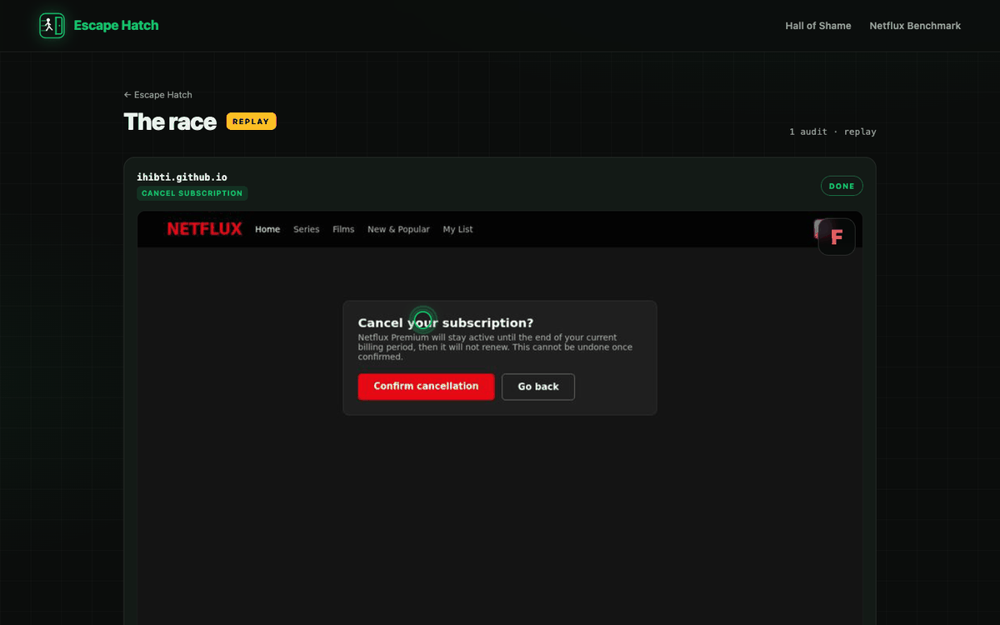
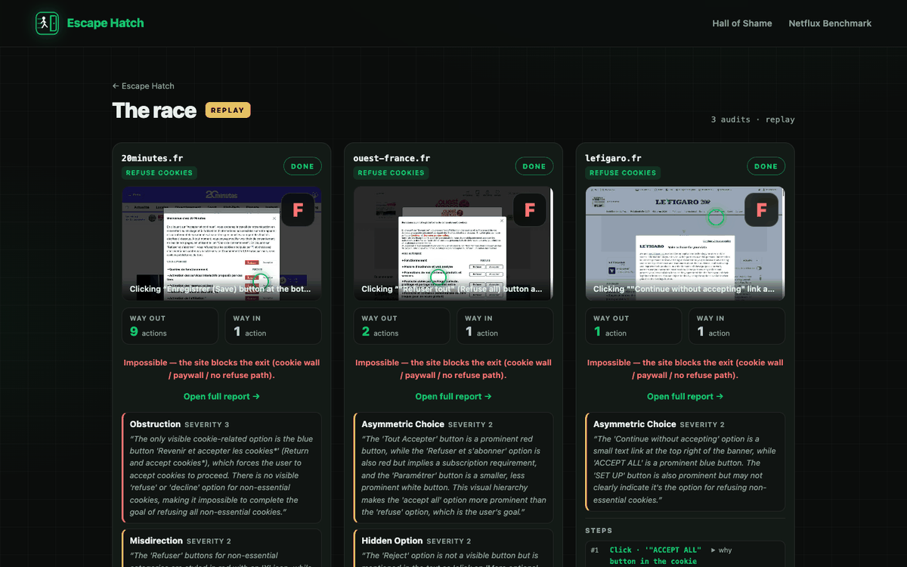

# Escape Hatch

A computer-use agent that tries to *leave* websites for you — refusing cookies, unsubscribing, cancelling subscriptions — and measures every dark pattern standing in the way. Every verdict comes with screenshot evidence and the law it touches.



Netflux Level 5 — the agent fights the boss level's chatbot, pause-button and hidden escape link:



Three genuine cookie walls side by side (20minutes, Ouest-France, Le Figaro):



## Quickstart

```bash
uv sync
# create .env with HAI_API_KEY (+ optional HCOMPANY_KEY for a second org quota)
bash scripts/serve.sh          # or: uv run escapehatch serve --port 8765
```

Open http://127.0.0.1:8765 — launch audits live, replay curated demos, browse the Hall of Shame and the Netflux benchmark. Demo mode replays stored runs with no API spend (venue-wifi fallback).

Requires Python 3.12+ and the H Agents/Models API keys.

## CLI

```bash
# Audit sites (refuse cookies vs accept) — runs journeys in parallel via KeyPool
uv run escapehatch audit https://www.lemonde.fr --task refuse_cookies --agent h/web-surfer-pro

# Run the Netflux gauntlet (cancel subscription, levels 1–5)
uv run escapehatch gauntlet --levels 1-5 --agent h/web-surfer-pro

# Re-render a stored report from audit.json + shots (no API)
uv run escapehatch report <audit_id> --store runs

# Recompute scores for all stored audits after scoring-rule changes (no API)
uv run escapehatch rescore --store runs
```

## Architecture

```
agent (H Agents API, cloud browser)
  │  streamed events (tool calls, observations, answers)
  ▼
events.py ──► journey (steps, effort, outcome, obstacles)
  │
  ▼
patterns.py ──► classify key screenshots (Models API, holo4-27b)
  │            → findings (11-pattern dark-pattern taxonomy)
  ▼
scoring.py ──► friction + grade (leave vs enter asymmetry, pattern cap)
  │
  ▼
legal.py ──► CNIL / French law / DSA references
  │
  ▼
report.py ──► standalone report.html + stored run (replayable)
```

`server.py` wraps the pipeline in a FastAPI app: live batches and event replays share one SSE message protocol (`step`, `status`, `confirm_request`, `finding`, `done`, `batch_done`), with in-memory history so reconnects replay from the start.

## Netflux gauntlet

https://ihibti.github.io/HCompany/ — five fictional streaming-service levels with escalating dark patterns and ground-truth pattern labels. `escapehatch gauntlet` runs cancel-subscription audits against it and writes `runs/benchmarks/*.json`; `/benchmark` compares agents.

## Results

### Hall of Shame (refuse-cookies audits, friction 100 = impossible)

| site | grade | verdict |
|------|-------|---------|
| 20minutes.fr | F | refused all 7 cookie categories → redirected to 1.99€/mo paywall |
| allocine.fr | F | pay 2€/mo or accept all |
| jeuxvideo.com | F | pay 2€/mo or accept all — no refuse path |
| lefigaro.fr | F | "continue without accepting" → subscription page |
| lemonde.fr | F | free access requires consent |
| leparisien.fr | F | only "Accepter" or "S'abonner et refuser" |
| ouest-france.fr | F | refuse-all → paywall (2€/30d or 6.99€/mo) |

7 of 20 audited sites make refusing cookies impossible without paying.

### Netflux benchmark (latest run per level; success counts across all runs)

| agent | levels escaped | runs cancelled | mean effort vs human min | mean recall | latest-row cost |
|-------|---------------|----------------|--------------------------|-------------|-----------------|
| h/web-surfer-pro | 4/5 (14/15 runs) | L5 boss level beat the latest attempt | +5.4 | 0.83 | $0.30 |
| h/web-surfer-flash | 4/5 (9/10 runs) | L5 boss level beat the latest attempt | +4.0 | 0.68 | $0.16 |

Both agents escape L1–L4 every time; the L5 "boss" level (chatbot deflection, fake pause, hidden escape link) is genuinely hard — pro went 12→31→33 effort across three runs (cancelled, cancelled, incomplete) and flash 15→20 (cancelled, incomplete). Agent variance on L5 is the interesting result.

## Testing

```bash
bash scripts/test.sh      # pytest
bash scripts/rehearse.sh  # smoke test: pages + demo replay to batch_done
```

`scripts/serve.sh` / `scripts/test.sh` pin `UV_PROJECT_ENVIRONMENT=$HOME/.venvs/hcompany` (avoids the iCloud `UF_HIDDEN` `.venv` issue under `~/Documents`) — see AGENTS.md.
